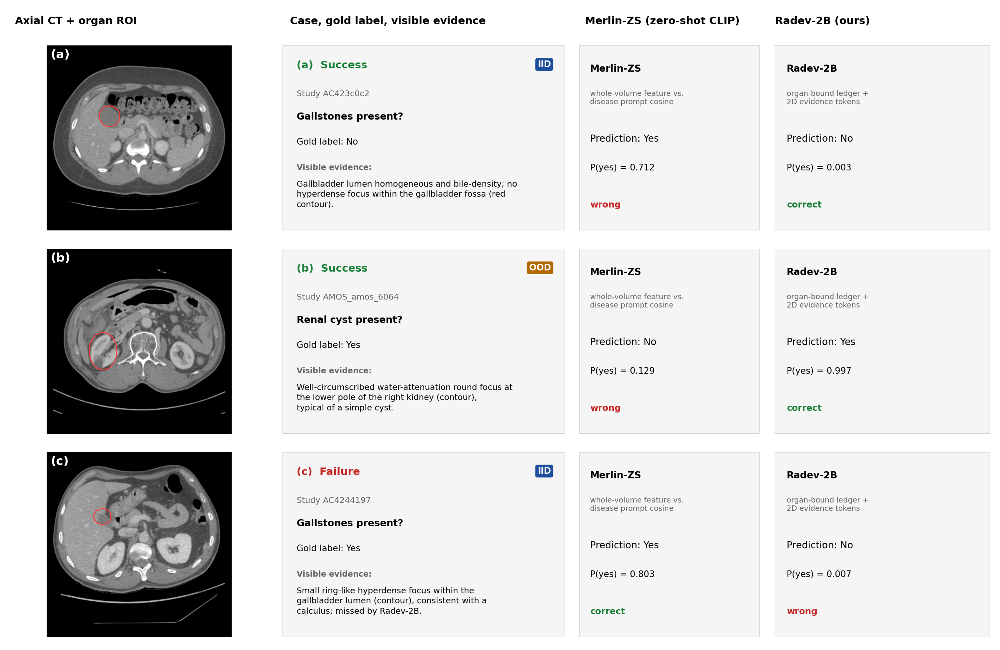

# Radev: Decision-Native Multimodal Clinical Modeling for 3D CT

Radev reads a whole 3D abdominal CT volume together with a clinical question and a small
candidate set, and emits a **calibrated probability distribution over the candidates in a
single forward pass** — no autoregressive decoding, no free-text generation. Anatomical
grounding (an organ-bound evidence ledger plus bound 2D evidence tokens) tells the model
*where* to look; counterfactual-calibrated training tells it *how sure* to be.

This repository contains the published model arm, the three-stage training pipeline, and
the evaluation/calibration code for the **CT-Verdict** benchmark (IID + OOD).


*Two successes and one failure of Radev-2B against a zero-shot CLIP baseline (Merlin-ZS).
Red contours mark the question-bound organ. (a) IID: normal gallbladder, baseline hallucinates
stones. (b) OOD: simple renal cyst, missed by the baseline. (c) IID failure: a visible
ring-like calculus missed by Radev-2B.*

## Highlights

- **Decision-native readout.** Restricted softmax over single-token candidates; one forward
  pass yields the full answer distribution (probabilities, not just an argmax).
- **Anatomical grounding.** A frozen 3D encoder pools per-organ features into an evidence
  ledger; each question binds to its target organs and their 2D evidence slices.
- **Confidence calibration.** Counterfactual-calibrated training (CCT) ablates the bound
  evidence and penalizes overconfidence when the answer should not change.
- **CT-Verdict benchmark.** 56,825 IID test questions (binary findings, multiple choice,
  ordinal severity) and 2,807 OOD questions on external volumes, prediction-only.

## Results (published Radev-2B arm)

| Split | Question type | n | Acc | mBAcc | mAUC | MAE | QWK |
|---|---|---|---|---|---|---|---|
| IID | binary finding (noul) | 37,925 | **90.08** | 71.79 | 87.79 | — | — |
| IID | multiple choice | 16,210 | **71.33** | 62.06 | 81.91 | — | — |
| IID | ordinal severity (score) | 2,690 | — | — | — | **0.392** | **53.75** |
| IID | triage subset | 1,034 | **82.88** | — | — | — | — |
| OOD | binary finding (noul) | 1,195 | **72.72** | — | 77.61 | — | — |

Calibration (ECE / Brier / KRPS) is reported by `analysis/verdict_metrics.py`; OOD labels
never enter fitting or model selection.

## Resources

| Asset | Location |
|---|---|
| Benchmark JSON (IID train/val/test, OOD test) | HF dataset [`Gavinnnnnnnn/CT-Verdict`](https://huggingface.co/datasets/Gavinnnnnnnn/CT-Verdict) |
| Published checkpoints (0.8B / 2B / 4B) | HF models `Gavinnnnnnnn/Radev-<size>` (access on request) |
| Benchmark documentation & statistics | [`doc/`](doc/) |
| Question → organ binding | [`organ_map.tsv`](organ_map.tsv) |

## Installation

```bash
git clone https://github.com/juntaoJianggavin/Radev.git && cd Radev
pip install torch numpy monai transformers pillow dynamic-network-architectures
```

Python ≥ 3.10 and a CUDA GPU are required for training and inference. The package is used
in-place (`python -m radev ...`); no build step.

## Data preparation

1. Download the benchmark JSON from HF into `data/iid/{train_val,test}.json` and
   `data/ood/test.json` (not stored in git due to size).
2. Place CT volumes where the relative `image` paths resolve, under `RADEV_IMAGE_ROOT`
   (default: repository root): `<root>/iid/<sid>.nii.gz` and `<root>/ood/ood_<n>.nii.gz`.
   Source cohorts and the identifier/image remap are documented in
   [`doc/identifier_remap.md`](doc/identifier_remap.md) and
   [`doc/ood_volume_map.tsv`](doc/ood_volume_map.tsv).
3. Build the frozen-encoder organ-feature cache: `GO=1 bash build_features.sh`.

## Evaluation

```bash
RUN=<ckpt_dir> bash evaluate.sh                                    # IID test
RUN=<ckpt_dir> EVAL_JSON=$PWD/data/ood/test.json bash evaluate.sh  # OOD test
python analysis/verdict_metrics.py --run <ckpt_dir>                # ECE / Brier / KRPS
```

`evaluate.sh` writes per-question verdicts (`verdicts_*.jsonl`) and `report_test.md`
(Acc / mBAcc / mAUC / MAE / QWK). Multi-GPU: `--num-shards N --shard i`, then `--merge-shards`.

## Training (three stages)

Every launcher is env-overridable and defaults to a **dry run** (`GO=0` prints the resolved
command; `GO=1` executes). Checkpoints land under `checkpoints/` (`OUT_ROOT`).

```bash
GO=1 bash build_features.sh                          # organ-feature cache (frozen encoder)
GO=1 bash run_alignment.sh                           # 1: projector + evidence attention
GO=1 bash run_vft.sh                                 # 2: verdict fine-tuning (full params)
GO=1 SRC=<vft_run_dir> bash run_cct.sh               # 3: counterfactual-calibrated training
```

Stage 3 initializes from the VFT checkpoint (`SRC`). Knob semantics (`--racd-*`, freezing,
loss weights) are documented in the launchers and `python -m radev train --help`.

## External assets (not distributed here)

| Asset | Env override | Notes |
|---|---|---|
| Language hosts (Qwen3.5 family) | `LLM_ROOT` | `pretrained/Qwen3.5-{0.8B,2B,4B,9B}` |
| Frozen 3D encoder + text embedding | `RADAR_CKPT_ROOT` | `checkpoint_radar_plus_finetuned.pth`, `infer_text_embedding.pt` |
| Organ-feature / slice caches | `VISUAL_ROOT`, `SLICE_ROOT` | rebuild with `build_features.sh` |
| CT volumes | `RADEV_IMAGE_ROOT` | see Data preparation |

The encoder identity is `radar_ft`; caches built under older identities must be rebuilt.

## Repository layout

```
radev/                  model, training loop, losses, evaluation engine
analysis/               verdict_metrics.py (ECE / Brier / KRPS)
data/                   benchmark JSON (from HF; git-ignored)
doc/                    dataset documentation, statistics, remap tables
assets/                 figures
run_*.sh, evaluate.sh   stage launchers and inference
build_features.sh       frozen-encoder feature-cache builder
organ_map.tsv           question -> organ binding
question_keep.tsv       per-question split + rule families (IID)
newq_keep.tsv           per-question split + families (extended)
geometry_scan.json      per-study organ geometry for the cache planner
```

## Citation

```bibtex
@misc{radev2026,
  title        = {Decision-Native Multimodal Clinical Modeling via Anatomical Grounding and Confidence Calibration},
  year         = {2026},
  howpublished = {GitHub repository},
  url          = {https://github.com/juntaoJianggavin/Radev}
}
```