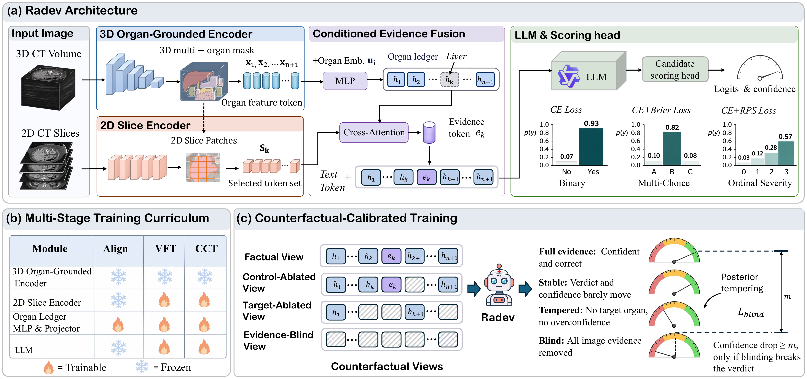

# Radev: Decision-Native Multimodal Clinical Modeling via Anatomical Grounding and Confidence Calibration

<p align="center">
    <a href="#"></a>
    <a href="https://huggingface.co/datasets/Gavinnnnnnnn/CT-Verdict"></a>
    <a href="https://huggingface.co/Gavinnnnnnnn/Radev-0.8B"></a>
    <a href="https://huggingface.co/Gavinnnnnnnn/Radev-2B"></a>
    <a href="https://juntaojianggavin.github.io/projects/Radev"></a>
</p>

<p align="center">
  Juntao Jiang<sup>*1,2</sup> ·
  Wenqi Zhong<sup>*2,3,1</sup> ·
  <a href="https://gyguo.github.io/">Guangyu Guo</a><sup>*2,3,1</sup> ·
  Dexia Chen<sup>2,3</sup> ·
  Yilong Hu<sup>2,3</sup> ·
  <a href="https://scholar.google.com/citations?user=5kJ22ZMAAAAJ">Yunhao Bai</a><sup>2,4</sup> ·
  <a href="https://scholar.google.com/citations?user=yoY2un8AAAAJ">Zhenyu Yi</a><sup>5</sup> ·
  <a href="https://scholar.google.com/citations?user=qirP1UIAAAAJ">Jianwei Xu</a><sup>2,3,1</sup> ·
  <a href="https://cwmok.github.io/">Tony C. W. MOK</a><sup>2,3,1</sup> ·
  Muxuan Gao<sup>1</sup> ·
  <a href="https://fabiozhang0722.github.io/">Ling Zhang</a><sup>2</sup> ·
  <a href="https://april.zju.edu.cn/team/dr-yong-liu/">Yong Liu</a><sup>1</sup> ·
  <a href="https://zhangzjn.github.io/">Jiangning Zhang</a><sup>†1</sup> ·
  <a href="https://ericzw.github.io/">Zhongwei Qiu</a><sup>†2,3,1</sup>
</p>

<p align="center">
  <sup>1</sup>Zhejiang University ·
  <sup>2</sup>DAMO Academy, Alibaba Group ·
  <sup>3</sup>Hupan Lab ·
  <sup>4</sup>East China Normal University ·
  <sup>5</sup>Shanghai Jiao Tong University
</p>

<p align="center"><sub><sup>*</sup>Equal contribution · <sup>†</sup>Corresponding author</sub></p>

Radev is a decision-native multimodal model for 3D abdominal CT interpretation. It reads a
whole CT volume together with a clinical question and a small candidate set, and emits a
**calibrated probability distribution over the candidates in a single forward pass**, without
autoregressive decoding or free-text generation. Anatomical grounding tells the model where to
look, and counterfactual-calibrated training tells it how sure to be. We evaluate Radev on
**CT-Verdict**, a benchmark of single-token verdicts (binary finding presence, multiple choice,
and ordinal severity) with an IID cohort and a prediction-only OOD cohort.

This repository provides the published model arm, the three-stage training pipeline, and the
evaluation and calibration code for CT-Verdict (IID + OOD).

## Updates

- **[2026-11]** Radev-0.8B and Radev-2B checkpoints, the CT-Verdict benchmark, and the training
  and evaluation code are released.


*Framework of Radev (paper Fig. 2). (a) Organ-grounded 3D encoder and query-conditioned 2D
evidence fusion feed a single-pass candidate scoring head. (b) Three-stage training
curriculum: alignment, verdict fine-tuning, counterfactual-calibrated training (CCT).
(c) CCT ablates target vs. control organ evidence: confidence must drop only when removing
the target organ breaks the verdict.*

## Highlights

- **Decision-native readout.** Restricted softmax over single-token candidates; one forward
  pass yields the full answer distribution (probabilities, not just an argmax).
- **Anatomical grounding.** A frozen 3D encoder pools per-organ features into an evidence
  ledger; each question binds to its target organs and their 2D evidence slices.
- **Confidence calibration.** Counterfactual-calibrated training (CCT) ablates the bound
  evidence and penalizes overconfidence when the answer should not change.
- **CT-Verdict benchmark.** 223,286 training/validation questions and 56,825 IID test questions
  (binary findings, multiple choice, ordinal severity), plus 2,807 OOD questions on external
  volumes (prediction-only).

## Results

Paper Tables 1–2. Acc is per-question exact-match accuracy; mBAcc/mAUC are macro means over
finding diseases; Score MAE/KRPS/QWK are over levels 0–4. **Bold** = best in column.
OOD labels never enter fitting or model selection.

### CT-Verdict-IID — binary findings (Noul)

| Model | Acc↑ | mBAcc↑ | mAUC↑ | ECE↓ | Brier↓ |
|---|---|---|---|---|---|
| LLaVA-Med-7B | 39.94 | 50.61 | 61.31 | 0.35 | 0.71 |
| RadFM | 58.88 | 50.03 | 51.72 | 0.11 | 0.47 |
| CT-Chat | 41.92 | 50.09 | 52.07 | 0.34 | 0.71 |
| M3D-Phi3-4B | 47.48 | 54.55 | 57.85 | 0.50 | 1.01 |
| M3D-Llama2-7B | 52.31 | 50.45 | 52.27 | 0.18 | 0.61 |
| Merlin | 66.56 | 56.06 | 79.70 | 0.16 | 0.43 |
| HealthGPT-M3 | 43.14 | 49.79 | 55.40 | 0.32 | 0.71 |
| Med3DVLM | 63.13 | 50.44 | 54.94 | 0.28 | 0.65 |
| InternVL3.5-8B | 43.94 | 53.67 | 72.44 | 0.24 | 0.57 |
| Hulu-med-4B | 50.71 | 57.72 | 74.71 | 0.13 | 0.47 |
| Hulu-med-7B | 64.67 | 61.73 | 78.71 | 0.07 | 0.41 |
| Qwen3.5-4B | 53.16 | 58.44 | 75.02 | 0.15 | 0.51 |
| Qwen3.5-9B | 57.90 | 63.08 | 76.58 | 0.09 | 0.44 |
| OmniCT-3B | 44.79 | 52.28 | 56.73 | 0.16 | 0.54 |
| OmniCT-7B | 40.27 | 50.00 | 39.73 | 0.25 | 0.61 |
| HealthGPT-Pro-4B | 70.96 | 65.90 | 76.68 | 0.10 | 0.41 |
| HealthGPT-Pro-8B | 62.03 | 68.04 | 77.31 | 0.02 | 0.45 |
| ClinFusion-8B | 65.66 | 56.58 | 64.68 | 0.08 | 0.44 |
| GPT-5.4 | 70.23 | 69.24 | – | – | – |
| OmniMed-Jev | 59.68 | 50.55 | 50.66 | 0.39 | 0.78 |
| Intern-Decision-2B | 57.32 | 60.66 | 71.09 | 0.02 | 0.48 |
| Intern-Decision-4B | 64.95 | 60.20 | 70.92 | 0.04 | 0.43 |
| Jev-1.14 | 71.39 | 65.14 | 79.31 | 0.04 | 0.37 |
| **Radev-0.8B (ours)** | 88.20 | 66.59 | 85.48 | 0.01 | 0.17 |
| **Radev-2B (ours)** | **90.08** | **71.79** | **87.79** | **0.01** | **0.15** |

### CT-Verdict-IID — multiple choice (Choice)

| Model | Acc↑ | mBAcc↑ | mAUC↑ | ECE↓ | Brier↓ |
|---|---|---|---|---|---|
| LLaVA-Med-7B | 19.69 | 49.82 | 50.15 | 0.42 | 1.05 |
| RadFM | 39.36 | 49.92 | 50.42 | 0.25 | 0.89 |
| CT-Chat | 22.30 | 50.21 | 52.22 | 0.41 | 1.11 |
| M3D-Phi3-4B | 9.71 | 50.01 | 50.95 | 0.85 | 1.72 |
| M3D-Llama2-7B | 8.72 | 50.01 | 50.39 | 0.81 | 1.67 |
| Merlin | 38.22 | 50.56 | 61.49 | 0.14 | 0.77 |
| HealthGPT-M3 | 23.12 | 50.19 | 52.93 | 0.25 | 0.89 |
| Med3DVLM | 28.74 | 50.89 | 52.75 | 0.52 | 1.21 |
| InternVL3.5-8B | 20.23 | 49.34 | 49.62 | 0.48 | 1.16 |
| Hulu-med-4B | 30.31 | 52.86 | 64.08 | 0.27 | 0.94 |
| Hulu-med-7B | 29.00 | 56.00 | 67.44 | 0.17 | 0.83 |
| Qwen3.5-4B | 29.69 | 52.54 | 64.87 | 0.29 | 0.92 |
| Qwen3.5-9B | 36.64 | 54.52 | 67.60 | 0.24 | 0.79 |
| OmniCT-3B | 23.79 | 50.25 | 55.46 | 0.37 | 1.00 |
| OmniCT-7B | 19.44 | 50.57 | 54.89 | 0.33 | 0.97 |
| HealthGPT-Pro-4B | 37.50 | 55.73 | 69.57 | 0.07 | 0.74 |
| HealthGPT-Pro-8B | 35.93 | 55.89 | 67.80 | 0.08 | 0.76 |
| ClinFusion-8B | 37.65 | 51.26 | 56.51 | 0.11 | 0.72 |
| GPT-5.4 | 45.92 | **64.31** | – | – | – |
| OmniMed-Jev | 36.06 | 51.39 | 57.91 | 0.37 | 0.93 |
| Intern-Decision-2B | 38.05 | 58.92 | 68.82 | 0.03 | 0.72 |
| Intern-Decision-4B | 45.49 | 57.37 | 65.17 | **0.02** | 0.68 |
| Jev-1.14 | 50.99 | 58.52 | 71.78 | 0.02 | 0.63 |
| **Radev-0.8B (ours)** | 68.61 | 57.73 | 78.19 | 0.02 | 0.44 |
| **Radev-2B (ours)** | **71.33** | 62.06 | **81.91** | 0.02 | **0.41** |

### CT-Verdict-IID — ordinal severity (Score)

| Model | MAE↓ | KRPS↓ | QWK↑ | ECE↓ | Brier↓ |
|---|---|---|---|---|---|
| LLaVA-Med-7B | 0.75 | 0.14 | 0.15 | 0.19 | 0.93 |
| RadFM | 0.93 | 0.21 | 0.07 | 0.54 | 1.19 |
| CT-Chat | 0.96 | 0.18 | -0.08 | 0.46 | 1.03 |
| M3D-Phi3-4B | 0.99 | 0.21 | 0.11 | 0.51 | 1.13 |
| M3D-Llama2-7B | 1.00 | 0.22 | -0.01 | 0.60 | 1.32 |
| Merlin | 0.70 | 0.14 | 0.13 | 0.24 | 0.89 |
| HealthGPT-M3 | 1.04 | 0.18 | 0.06 | 0.12 | 0.83 |
| Med3DVLM | 0.80 | 0.17 | 0.29 | 0.44 | 1.04 |
| InternVL3.5-8B | 1.05 | 0.17 | -0.02 | 0.09 | 0.78 |
| Hulu-med-4B | 1.06 | 0.17 | 0.24 | 0.11 | 0.80 |
| Hulu-med-7B | 1.39 | 0.24 | 0.22 | 0.25 | 0.95 |
| Qwen3.5-4B | 1.12 | 0.19 | 0.23 | 0.14 | 0.85 |
| Qwen3.5-9B | 1.27 | 0.22 | 0.19 | 0.16 | 0.88 |
| OmniCT-3B | 1.17 | 0.21 | 0.07 | 0.30 | 0.93 |
| OmniCT-7B | 0.88 | 0.15 | 0.02 | 0.19 | 0.81 |
| HealthGPT-Pro-4B | 1.05 | 0.17 | 0.30 | 0.13 | 0.80 |
| HealthGPT-Pro-8B | 0.93 | 0.15 | 0.34 | 0.09 | 0.77 |
| ClinFusion-8B | 1.02 | 0.17 | 0.22 | 0.09 | 0.81 |
| GPT-5.4 | 0.75 | – | 0.46 | – | – |
| OmniMed-Jev | 0.79 | 0.17 | 0.11 | 0.31 | 0.93 |
| Intern-Decision-2B | 0.57 | 0.10 | 0.40 | 0.07 | 0.68 |
| Intern-Decision-4B | 0.52 | 0.10 | 0.35 | 0.13 | 0.73 |
| Jev-1.14 | 0.60 | 0.12 | 0.36 | 0.21 | 0.79 |
| **Radev-0.8B (ours)** | 0.40 | 0.06 | 0.53 | 0.03 | 0.42 |
| **Radev-2B (ours)** | **0.39** | **0.06** | **0.54** | **0.02** | **0.41** |

### CT-Verdict-OOD (external volumes, prediction-only)

| Model | Noul Acc↑ | Noul mAUC↑ | Choice Acc↑ | Choice mAUC↑ | Score MAE↓ | Score KRPS↓ |
|---|---|---|---|---|---|---|
| LLaVA-Med-7B | 35.80 | 55.80 | 17.60 | 58.50 | 0.653 | 0.152 |
| RadFM | 55.70 | 43.50 | 55.40 | 46.00 | 0.582 | 0.130 |
| CT-Chat | 40.00 | 39.70 | 8.90 | 51.30 | 1.440 | 0.229 |
| M3D-Llama2-7B | 41.80 | 53.10 | 15.70 | 51.40 | 0.993 | 0.222 |
| Merlin | 61.30 | 69.90 | 11.20 | 62.70 | 0.501 | 0.141 |
| HealthGPT-M3 | 42.30 | 47.90 | 22.60 | 50.60 | 1.125 | 0.185 |
| Med3DVLM | 56.40 | 60.30 | 9.10 | 53.90 | 0.910 | 0.197 |
| InternVL3.5-8B | 42.00 | 64.70 | 18.10 | 56.70 | 0.945 | 0.159 |
| Hulu-med-7B | 64.90 | 66.20 | 19.60 | 71.40 | 1.417 | 0.237 |
| Qwen3.5-9B | 54.31 | 65.60 | 25.34 | 61.76 | 1.191 | 0.185 |
| OmniCT-7B | 41.80 | 45.40 | 14.00 | 57.00 | 0.943 | 0.147 |
| HealthGPT-Pro-8B | 56.70 | 71.60 | 35.00 | 70.20 | 0.990 | 0.162 |
| ClinFusion-8B | 55.73 | 47.40 | 58.18 | 57.17 | 1.143 | 0.177 |
| GPT-5.4 | 63.93 | – | 36.70 | – | 0.763 | – |
| OmniMed-Jev | 59.90 | 43.80 | 54.20 | 61.80 | 0.558 | 0.123 |
| Intern-Decision-4B | 63.30 | 64.60 | 53.70 | 58.60 | 0.321 | 0.106 |
| Jev-1.14 | 62.90 | 71.70 | 53.30 | 67.90 | 0.504 | 0.122 |
| **Radev-0.8B (ours)** | 69.96 | 72.89 | 65.79 | 72.31 | 0.279 | 0.032 |
| **Radev-2B (ours)** | **72.72** | **77.61** | **69.29** | **75.16** | **0.234** | **0.028** |

## Resources

| Asset | Location |
|---|---|
| Benchmark JSON (IID train/val/test, OOD test) | HF dataset [`Gavinnnnnnnn/CT-Verdict`](https://huggingface.co/datasets/Gavinnnnnnnn/CT-Verdict) |
| Published checkpoints (0.8B / 2B) | HF models [`Radev-0.8B`](https://huggingface.co/Gavinnnnnnnn/Radev-0.8B), [`Radev-2B`](https://huggingface.co/Gavinnnnnnnn/Radev-2B) (access on request) |
| Benchmark documentation & statistics | [`doc/`](doc/) |
| Question → organ binding | [`organ_map.tsv`](organ_map.tsv) |

## Installation

```bash
git clone https://github.com/juntaoJianggavin/Radev.git && cd Radev
pip install torch numpy monai transformers pillow dynamic-network-architectures
```

Python ≥ 3.10 and a CUDA GPU are required for training and inference. The package is used
in-place (`python -m radev ...`); no build step.

## Data preparation

1. Download the benchmark JSON from HF into `data/iid/{train_val,test}.json` and
   `data/ood/test.json` (not stored in git due to size).
2. Place CT volumes where the relative `image` paths resolve, under `RADEV_IMAGE_ROOT`
   (default: repository root): `<root>/iid/<sid>.nii.gz` and `<root>/ood/ood_<n>.nii.gz`.
   Source cohorts and the identifier/image remap are documented in
   [`doc/identifier_remap.md`](doc/identifier_remap.md) and
   [`doc/ood_volume_map.tsv`](doc/ood_volume_map.tsv).
3. Build the frozen-encoder organ-feature cache: `GO=1 bash build_features.sh`.

## Evaluation

```bash
RUN=<ckpt_dir> bash evaluate.sh                                    # IID test
RUN=<ckpt_dir> EVAL_JSON=$PWD/data/ood/test.json bash evaluate.sh  # OOD test
python analysis/verdict_metrics.py --run <ckpt_dir>                # ECE / Brier / KRPS
```

`evaluate.sh` writes per-question verdicts (`verdicts_*.jsonl`) and `report_test.md`
(Acc / mBAcc / mAUC / MAE / QWK). Multi-GPU: `--num-shards N --shard i`, then `--merge-shards`.

## Training (three stages)

Every launcher is env-overridable and defaults to a **dry run** (`GO=0` prints the resolved
command; `GO=1` executes). Checkpoints land under `checkpoints/` (`OUT_ROOT`).

```bash
GO=1 bash build_features.sh                          # organ-feature cache (frozen encoder)
GO=1 bash run_alignment.sh                           # 1: projector + evidence attention
GO=1 bash run_vft.sh                                 # 2: verdict fine-tuning (full params)
GO=1 SRC=<vft_run_dir> bash run_cct.sh               # 3: counterfactual-calibrated training
```

Stage 3 initializes from the VFT checkpoint (`SRC`). Knob semantics (`--racd-*`, freezing,
loss weights) are documented in the launchers and `python -m radev train --help`.

## External assets (not distributed here)

| Asset | Env override | Notes |
|---|---|---|
| Language hosts (Qwen3.5 family) | `LLM_ROOT` | `pretrained/Qwen3.5-{0.8B,2B,9B}` |
| Frozen 3D encoder + text embedding | `RADAR_CKPT_ROOT` | `checkpoint_radar_plus_finetuned.pth`, `infer_text_embedding.pt` |
| Organ-feature / slice caches | `VISUAL_ROOT`, `SLICE_ROOT` | rebuild with `build_features.sh` |
| CT volumes | `RADEV_IMAGE_ROOT` | see Data preparation |

The encoder identity is `radar_ft`; caches built under older identities must be rebuilt.

## Repository layout

```
radev/                  model, training loop, losses, evaluation engine
analysis/               verdict_metrics.py (ECE / Brier / KRPS)
data/                   benchmark JSON (from HF; git-ignored)
doc/                    dataset documentation, statistics, remap tables
assets/                 figures
run_*.sh, evaluate.sh   stage launchers and inference
build_features.sh       frozen-encoder feature-cache builder
organ_map.tsv           question -> organ binding
question_keep.tsv       per-question split + rule families (IID)
newq_keep.tsv           per-question split + families (extended)
geometry_scan.json      per-study organ geometry for the cache planner
```

## Citation

```bibtex
@misc{radev2026,
  title        = {Decision-Native Multimodal Clinical Modeling via Anatomical Grounding and Confidence Calibration},
  year         = {2026},
  howpublished = {GitHub repository},
  url          = {https://github.com/juntaoJianggavin/Radev}
}
```